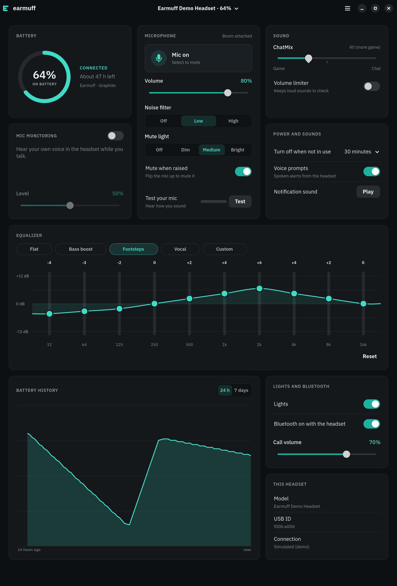
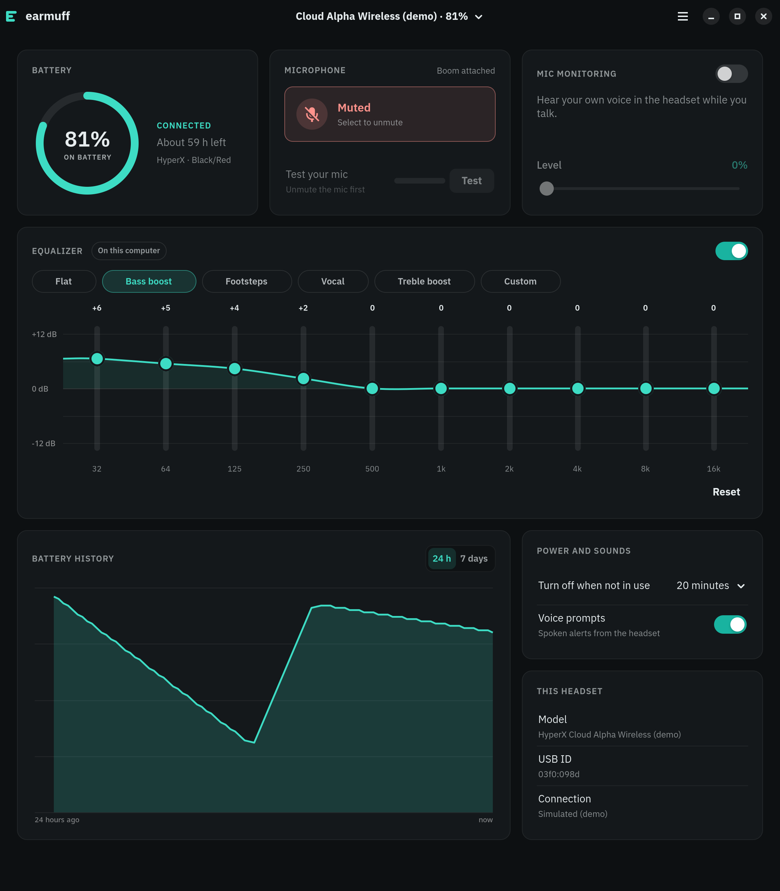

# Earmuff

Battery and settings for your gaming headset on Linux, in place of vendor apps
like HyperX NGENUITY. Written in Rust with GTK4 and libadwaita.



## Supported headsets

- **HyperX Cloud Alpha Wireless**, with Earmuff's own driver: instant updates and
  every setting read back from the headset.
- **About 40 more models** from Logitech, SteelSeries, Corsair, HyperX, Sony, Audeze,
  Jabra, Roccat and others, when [HeadsetControl](https://github.com/Sapd/HeadsetControl)
  is installed.

The full list with USB IDs is in [docs/supported-headsets.md](docs/supported-headsets.md).
No headset at hand? `earmuff --demo` runs everything with simulated ones. Yours isn't
listed? [Ask for it](https://github.com/Xlizer1/earmuff/issues/new?template=headset-support.yml),
with a few lines from `earmuff sniff`.

## What it does

Run `earmuff`, or open "Earmuff" from the app menu. Everything your headset has is on
one page, a panel per kind of setting, with a switcher in the header when more than one
headset is plugged in. The panels stay put: nothing jumps around when a setting changes.

**Battery.** Level and charging state, how long it has left, and a graph of the last
day or week. A notification says when the battery runs low (at a level you pick, and
again at half of it) and when it's fully charged.

**Microphone.** Mute (in sync with the button on the headset), volume, noise filter,
mute-when-raised and the mute light. A mic test records five seconds with a level
meter and plays them back.

**Sound.** Mic monitoring (hearing your own voice) and its level, ChatMix, the volume
limiter, and the headset's equalizer: its presets, or a curve of your own, dragged
band by band.

**A software equalizer** for headsets without one of their own, like the Cloud Alpha
Wireless. It runs on the computer, in PipeWire, for everything played through the
headset, with ten bands and presets for bass, footsteps, voices and treble.



**And the rest.** Lights, auto power-off, voice prompts, the notification sound and
the Bluetooth options. The headset's model, USB ID and how Earmuff reaches it.

Earmuff remembers each headset's settings and puts them back when it reconnects (some
headsets forget theirs when turned off). It can also make a headset the computer's
speakers and mic whenever it turns on. Both are in Preferences (Ctrl+,), with the
battery alerts and starting at login.

| Shortcut | Does |
|---|---|
| Ctrl+, | Preferences |
| F1 | About |
| Ctrl+W | Close the window (Earmuff stays in the tray) |
| Ctrl+Q | Quit |

### In the tray

Earmuff puts a headset icon in the system tray (Waybar's tray, KDE, or GNOME with the
AppIndicator extension). Hover it for the battery; right-click for mic mute, Open and
Quit. Like Discord, closing the window only hides it, and the app keeps running in
the tray until you pick Quit. On a desktop without a tray, closing the window quits.
Started at login, it waits in the tray without opening the window.

## Command line

```
earmuff list [--json]             headsets Earmuff can reach
earmuff status [--json]           battery and every setting
earmuff set SETTING VALUE         e.g. set sidetone 40%, set eq-preset "Bass boost"
earmuff set mute toggle           mute or unmute the mic, for a keyboard shortcut
earmuff play-sound N              play one of the headset's notification sounds
earmuff waybar                    JSON for a Waybar custom module
earmuff monitor [--raw]           print what the headset reports, live
earmuff sniff VID:PID             print every report any USB device sends, in hex
```

`-d VID:PID` picks a headset (see `earmuff list`); without it, Earmuff uses the
first one it finds. `earmuff set --help` lists every setting.

`earmuff set mute toggle` prints `Mic muted` or `Mic on`;
[docs/shortcuts.md](docs/shortcuts.md) shows how to bind it to a key on Hyprland, Sway,
GNOME and KDE.

`monitor --raw` and `sniff` print reports in hex: leave one running, press a button or
change a setting, and watch which bytes move. `sniff` works on any USB device, also
one Earmuff doesn't know yet, and never sends it anything. That's how new headsets
get supported; see [docs/protocols](docs/protocols).

### Waybar

Besides the tray icon, Waybar can show the battery as text, styled by the `ok`, `low`,
`charging` and `off` classes. It shows nothing while the dongle isn't plugged in.

```json
"custom/headset": {
    "exec": "earmuff waybar",
    "return-type": "json",
    "interval": 60,
    "format": "🎧 {}"
}
```

## Install

### Arch Linux

```
git clone https://github.com/Xlizer1/earmuff.git
cd earmuff/packaging/aur && makepkg -si
```

The package includes the udev rule that lets you open the headset's dongle.

### From source

You need Rust 1.88 or newer, GTK 4.16, libadwaita 1.5 and Pango 1.56 or newer, and
`glib-compile-resources` (part of GLib's development files).

```
make install        # into ~/.local; PREFIX=/usr/local for everyone
make install-udev   # lets you open the headset's dongle (asks for sudo)
```

`make install-udev` isn't needed if HeadsetControl is installed: its udev rule covers
the same dongles. `make uninstall` and `make uninstall-udev` remove everything again.

### What else it uses

- [HeadsetControl](https://github.com/Sapd/HeadsetControl) 3.0 or newer, for headsets
  other than the Cloud Alpha Wireless
- PipeWire's and WirePlumber's tools (`pw-dump`, `pw-cli`, `pw-record`, `pw-play`,
  `wpctl`), for the mic test, the software equalizer and switching the sound to a
  headset. Most desktops with PipeWire have them already.

## Development

Earmuff follows clean architecture: a Cargo workspace whose crates only depend inward.
[docs/architecture.md](docs/architecture.md) explains the layers and the tests, and
[CONTRIBUTING.md](CONTRIBUTING.md) how to work on it.

```
make check          # formatting, lints, unit, integration and end-to-end tests
make test-hardware  # tests on a real Cloud Alpha Wireless (switched on)
make screenshots    # retakes the pictures in this README
```

The window and tray tests run headless, on their own display and D-Bus session, so
nothing shows up on your desktop while they run.

## Credits

Command bytes for the Cloud Alpha Wireless come from
[HeadsetControl](https://github.com/Sapd/HeadsetControl) (GPL-3.0) and
[HyperHeadset](https://github.com/LennardKittner/HyperHeadset) (MIT).
Earmuff's typeface is [IBM Plex Sans](https://github.com/IBM/plex), under the SIL Open
Font License 1.1 ([data/fonts/OFL.txt](data/fonts/OFL.txt)).

## Trademarks

Earmuff isn't affiliated with or endorsed by HP, HyperX, SteelSeries, Logitech, Corsair
or any other headset maker. Product names are trademarks of their owners.

## License

GPL-3.0-or-later. See [LICENSE](LICENSE).
